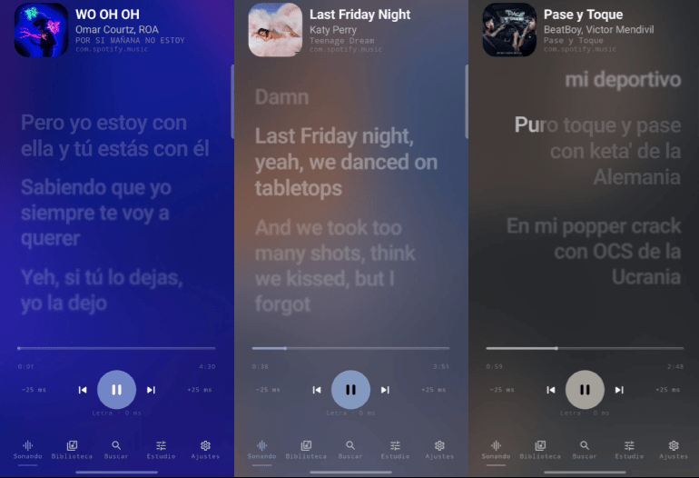
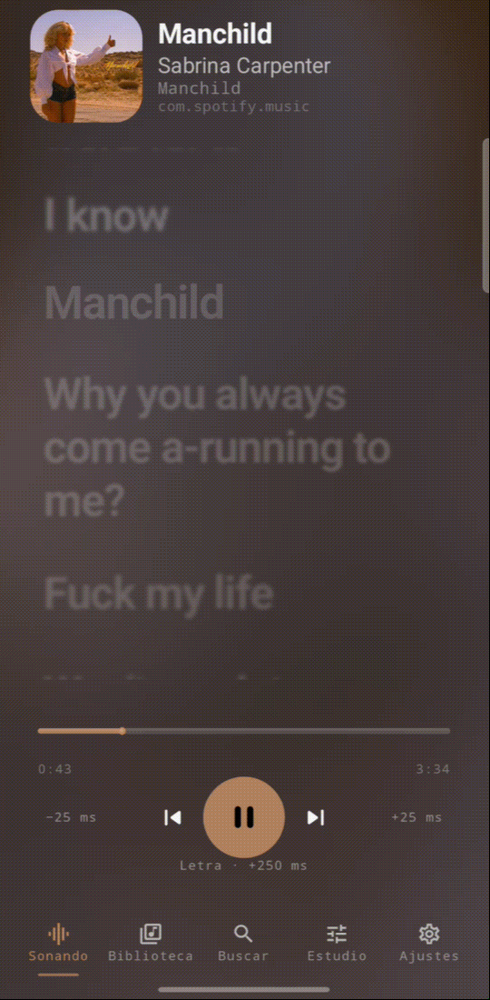
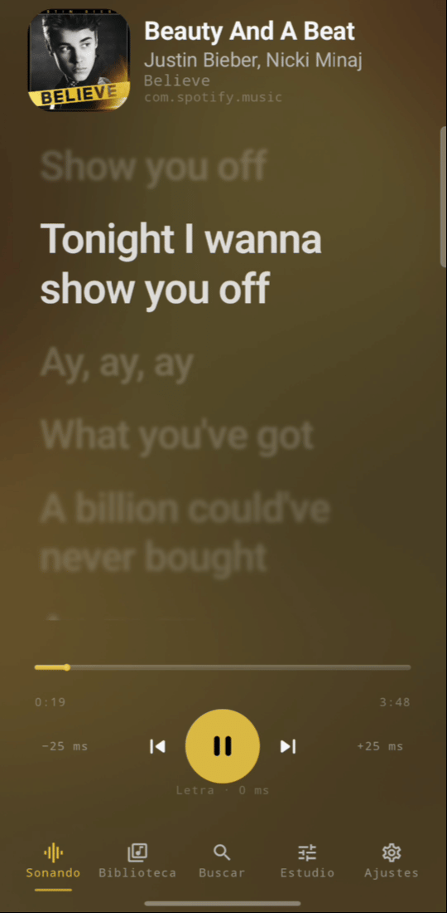
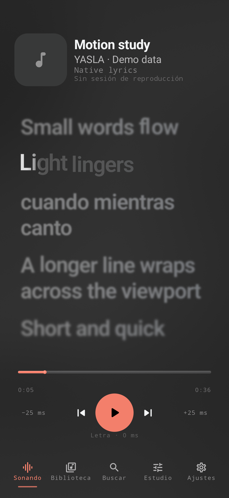
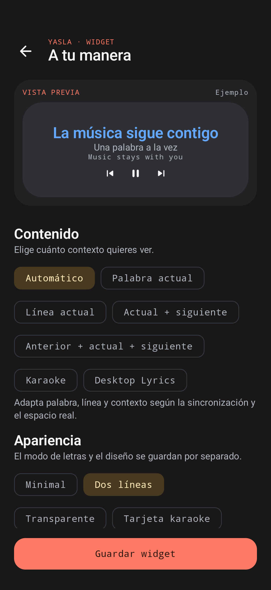

<div align="center">
  <h1 align="center">💿 Yet A Simple Lyrics App - YASLA 🎵</h1>
  <code>An open-source Android application for rendering TTML and AMLL lyrics, featuring widgets and overlay</code>
  <br>
  
  **YASLA** is a native Android lyrics companion focused on synchronized lyrics,
customization, home-screen widgets, floating lyrics and immersive music visuals.


---

  </img>
  
</div>

---

<div align="center">
<h>📱 How THIS looks on YOUR phone</h>

<table>
  <tr>
    <th>AMLL</th>
    <th>TTML</th>
    <th>Widget</th>
    <th>Overlay</th>
  </tr>
  <tr>
    <td align="center">
      
    </td>
    <td align="center">
      
    </td>
    <td align="center">Example</td>
    <td align="center">Example</td>
  </tr>
</table>

</div>

</div>




[Screenshot and motion capture guidance](docs/screenshots/README.md).
No demonstration GIF is published yet.

## What is available

| Area | Status | Current behavior |
| --- | --- | --- |
| Playback companion | Available | Android MediaSession listening, metadata, playback position and supported transport actions |
| Synchronized lyrics | Available | Line sync and word sync from timed lyric data |
| Import/export | Available | Plain text, LRC and TTML import; lyric export including TTML |
| Local library | Available | Imported lyrics and cached documents stored on the device with Room |
| Lyrics presentation | Available | Full lyrics and Current Word modes, translations and alignment options |
| Native motion | Available | Continuous line springs, semantic-word movement, measured karaoke reveal and subtle active-text glow |
| Artwork atmosphere | Available | A continuously animated procedural field whose palette comes from artwork |
| Home-screen widgets | Available | Content modes, presets, complete current words, responsive layout and saved per-widget settings |
| Floating Lyrics | Available | An Android overlay with separate layout and appearance controls |
| Personalization | Available | Dark/light themes, color options, motion levels and lyric timing offset |
| Public-release preparation | In development | Documentation, source curation, license review and release verification |
| Spotify Web API | Planned | User-configured application credentials and authorization; not implemented |
| Spotify App Remote | Planned | Direct Spotify SDK integration; not implemented |

Availability describes implemented code, not guaranteed compatibility with every
player or Android vendor. Previous/next, play/pause and seek follow the active
MediaController's capabilities.

## Lyrics and karaoke

YASLA understands plain text, line-timed LRC and supported TTML, including AMLL-style
word and syllable timing. A **LyricsWord** owns the complete visible word; its timed
segments control timing and internal reveal rather than fragmenting it into separate
visual syllables.

Now Playing uses a native Kotlin/Compose motion path. Line springs retain velocity
when interrupted, and the focus sits around 27% of the lyrics viewport. A measured
text mask drives the highlight. Pending text is darker; completed text stays lit
while its row remains active. Glow is restricted to illuminated glyphs.

Line-synced lyrics activate as a whole line; YASLA does not invent word timestamps.
Off and Reduced motion modes limit visual effects. Blur support differs by Android
version, and RTL words preserve contextual shaping. See the
[native motion notes](docs/AMLL_NATIVE_MOTION.md) and [license review](docs/LICENSE_STATUS.md).

## Widgets and Floating Lyrics

Widgets offer Auto, Current Word, Current Line, current/next context, previous/current/next,
Karaoke and Desktop Lyrics modes. Content mode and visual preset are saved separately.
The editor follows the same live snapshot as placed widgets, with text scale, colors, background opacity, corner radius,
vertical positioning, translations, playback controls, title fallback and a local Photo Picker image for idle playback.

The preview approximates launcher space. Current words use measured, balanced grapheme wrapping without ellipsis.
Interface language supports English, Spanish and the system default. Song metadata and lyrics are not translated.
Widgets use Glance/RemoteViews and update at relevant word or line boundaries;
they do not reproduce the app's continuous drawing animation.

Floating Lyrics uses Android's display-over-other-apps permission. Its renderer and
configuration are separate from the Now Playing motion path.

## Getting started

There is no public release/download link configured in this tree yet.
Build a debug APK, install it, then:

1. Enable media access from YASLA's Settings.
2. Start playback in a compatible music app.
3. Import a lyric file or use the configured lyric lookup providers.
4. Enable Floating Lyrics access if desired, or add a home-screen widget.

Playback controls may be disabled when the player does not expose the corresponding
action. Offset buttons adjust **lyrics timing**, not audio playback position.

## Build requirements

- Android Studio with support for Android Gradle Plugin **9.4.0**.
- The **Gradle 9.6.0 wrapper**, included in this tree.
- **JDK 25** for the configured Gradle daemon; Java/Kotlin bytecode targets Java 11.
- Android SDK platform for `compileSdk.release(37)` and the required build tools.
  The validated local SDK resolves the platform as `android-37.0`.
- Android **7.0 / API 24** or newer to run the app; target SDK is 37.

Open the project in Android Studio and let it resolve the SDK/toolchain. Keep generated
`local.properties` local. The first dependency resolution needs network access.

```powershell
.\gradlew.bat :app:assembleDebug
.\gradlew.bat :app:testDebugUnitTest :core:domain:test :app:lintDebug
.\gradlew.bat :app:connectedDebugAndroidTest
```

```sh
./gradlew :app:assembleDebug
```

The debug APK is generated at `app/build/outputs/apk/debug/app-debug.apk`.
Use `--offline` only after dependencies and toolchains are cached.
See [BUILDING.md](docs/BUILDING.md) for instrumentation and release preparation.

## Architecture

```text
app/          Compose UI, MediaSession monitoring, storage, providers and Android surfaces
core/domain/  Lyric models, parsing/export, word reconstruction and synchronization
```

`LyricsAppContainer` owns the playback timeline. Lyrics, overlays and widgets consume
that shared state. Room stores the lyric library; DataStore and visual preferences
store settings. The Now Playing renderer keeps high-frequency work in drawing/layer
updates and uses one viewport frame coordinator rather than one coroutine per word.

## Spotify

YASLA is independent and is **not an official Spotify product**.
Today, Spotify can be a playback/metadata source through Android MediaSession, like
other compatible players. This does not mean the Spotify Web API or App Remote SDK
has been integrated.

⚠️ YASLA follows playback from compatible music apps. It does not stream or host music.

Those integrations are **planned**. Users will configure their own Spotify Developer
application Client ID and redirect URI when that feature exists. A mobile Web API
flow should use [Authorization Code with PKCE](https://developer.spotify.com/documentation/web-api/tutorials/code-pkce-flow);
a client secret must not be embedded in the APK. App Remote has its own
[registration and authorization requirements](https://developer.spotify.com/documentation/android/tutorials/getting-started).
Spotify's [current quota rules](https://developer.spotify.com/documentation/web-api/concepts/quota-modes)
also need review during implementation. No Spotify credentials are required by the
current MediaSession-based implementation.

## Roadmap

- Resolve source-guided AMLL motion obligations alongside the chosen GPL-3.0 license.
- Complete transitive dependency notices and asset-rights review.
- Expand physical-device testing, including 60/120 Hz and vendor behavior.
- Validate accessibility, large fonts and launcher widget sizes across devices.
- Implement the planned Spotify integrations without shipping shared secrets.
- Establish signing, release distribution and private security-reporting channels.

## Contributing

Read [CONTRIBUTING.md](CONTRIBUTING.md), [CODE_OF_CONDUCT.md](CODE_OF_CONDUCT.md) and
[SECURITY.md](SECURITY.md). Keep changes scoped and protect playback, word reconstruction,
widget updates and the procedural background from unrelated regressions.

Original YASLA contributions use GPL-3.0; retain third-party notices and provenance.

## Credits

Built with Kotlin, AndroidX, Jetpack Compose, Room, DataStore, Glance, Palette and Coroutines.
AMLL is an important motion research reference; Apple Music is an aesthetic inspiration,
not an affiliation. LRCLIB is the implemented remote lyric provider.

See [THIRD_PARTY_NOTICES.md](THIRD_PARTY_NOTICES.md) for verified dependency licenses
and [LICENSE_STATUS.md](docs/LICENSE_STATUS.md) for the unresolved AMLL provenance.
Song lyrics and artwork carry their own rights independently of software licenses.

## License

Original YASLA code is licensed under [GNU GPL-3.0](LICENSE), as selected by the maintainer.
Third-party dependencies retain their licenses. The source-guided native AMLL motion
has a documented AGPL-3.0 provenance concern; this GPL choice does not remove those
potential obligations. See [LICENSE_STATUS.md](docs/LICENSE_STATUS.md).
