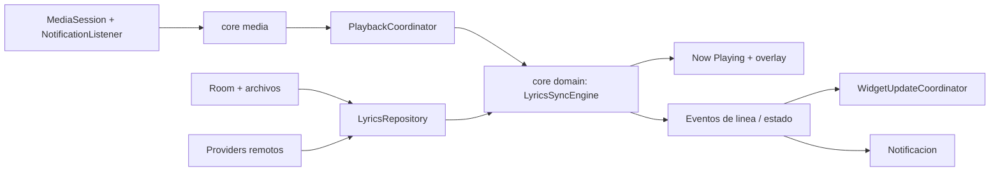

# Arquitectura propuesta — letras sincronizadas para Android

> Nota histórica de planificación. El estado implementado vigente está en [README.md](../README.md); la evaluación de licencia actual está en [LICENSE_STATUS.md](LICENSE_STATUS.md).

Fecha de inspección: 12 de septiembre de 2026 (America/Tijuana).
Proyecto: `<project root>`.
Estado: arquitectura revisada y Fase 0 implementada. Las fases de integración con reproductores, red, persistencia, overlay y widgets siguen pendientes.

**Decisión principal:** construir una aplicación Android nativa con un modelo de letras independiente del formato, un único coordinador de reproducción/sincronización y renderizadores distintos para Compose y AppWidgets. La estructura inicial no justifica crear de golpe todos los módulos de la lista original.

**Base implementada:** el proyecto ya contiene `:core:domain` Kotlin/JVM, modelos de letras y reproducción, contrato de providers, `LyricsSyncEngine` con `StateFlow` y reloj monotónico, además de una Activity launcher con Compose Material 3 y un estado vacío adaptable. No se añadieron permisos, servicios, proveedores remotos, Room, overlay, widgets ni reproducción ficticia.

## 1. Evidencia del proyecto actual

“Evidencia” describe archivos o resultados observados. “Propuesta” describe trabajo futuro. “Pendiente” no está verificado.

| Área | Evidencia |
|---|---|
| Proyecto abierto | MCP `ide_project_status`: yetasimplelyicsapp, abierto, no gestionado por lifecycle MCP |
| Índice | `isDumbMode=false`, `isIndexing=false` |
| Módulos Gradle | `:app` Android y `:core:domain` Kotlin/JVM |
| Producción | Activity/UI Compose en `:app`; modelos, provider contract y sync engine en `:core:domain` |
| Activity / Application | `MainActivity` launcher declarada; todavía no existe Application propia, servicios, receivers ni permisos |
| Editor activo | MCP devuelve `activeFiles=[]` |
| UI | Compose Material 3, tema claro/oscuro con dynamic color opcional y shell adaptable; navegación funcional todavía pendiente |
| Build | AGP 9.4.0; Gradle 9.6.0 con checksum; compileSdk/targetSdk 37; minSdk 24 |
| Java/Kotlin | Source/target Java 11; criterio de JVM Gradle 25; Kotlin stdlib resuelta 2.2.10 |
| Dependencias directas | Core KTX 1.19.0, Activity Compose 1.13.0, Compose BOM 2026.09.00, Material 3 y Coroutines 1.11.0 |
| Transitivas relevantes | Compose UI/Foundation 1.12.0 y dependencias AndroidX resueltas por BOM; todavía no hay stack de reproducción |
| Tests | JUnit 4.13.2, AndroidX JUnit 1.3.0 y Espresso 3.7.0; 9 tests de dominio, 1 test local de plantilla y 1 instrumentado pendiente de dispositivo |
| Persistencia/red | Sin Room, DataStore, Glance, HTTP client, parsers ni implementaciones de providers |
| Control de versiones | No hay `.git` en la raíz inspeccionada; no se creó repositorio |
| Backup/release | Backup habilitado con reglas de ejemplo; optimización release deshabilitada |

Fuentes locales: `app/build.gradle.kts:1-40`, `gradle/libs.versions.toml:1-19`, `gradle/wrapper/gradle-wrapper.properties:4-5`, `gradle/gradle-daemon-jvm.properties:12`, `app/src/main/res/values/themes.xml:3-13`.

La ausencia de `org.jetbrains.kotlin.android` **no es un defecto**: AGP 9+ incorpora Kotlin. La documentación de AGP 9.4 confirma API 37 y Gradle mínimo 9.6.0. No se propone rebajar versiones ni copiar la configuración Gradle de los proyectos de referencia. Al añadir Compose/KSP se verificará su compatibilidad con el compilador efectivo. [Kotlin integrado](https://developer.android.com/build/migrate-to-built-in-kotlin), [compatibilidad AGP 9.4](https://developer.android.com/build/releases/agp-9-4-0-release-notes).

### Diagnóstico y pruebas iniciales

- MCP `ide_project_diagnostics`: **27/27 archivos analizados**, `complete=true`, **0 errores, 14 warnings**, 22.255 s. Todos mediante análisis cerrado; no incluye weak warnings ni anotadores exclusivos del editor.
- 3 warnings por namespace `tools` sin uso; 5 por nuevas versiones de dependencias; 2 avisos del wrapper Gradle; 4 avisos de API `@Incubating` en repositorios de settings. Son avisos, no fallos de compilación.
- MCP `ide_build_project`: `success=true`, `aborted=false`, 90.190 s. Ejecutó compileDebugSources, compileDebugUnitTestSources y compileDebugAndroidTestSources. Sus contadores de errores/warnings son `null`: **no se interpretan como cero**. El log bruto sólo conservó progreso de descargas.
- MCP `ide_list_tests`: `ExampleUnitTest.addition_isCorrect` y `ExampleInstrumentedTest.useAppContext`.
- MCP `ide_run_tests` no pudo crear configuración para el FQN válido del test. Se resolvió la comprobación con Gradle, sin editar tests.
- `gradlew.bat :app:assembleDebug :app:testDebugUnitTest :app:lintDebug --console=plain`: **BUILD SUCCESSFUL**, 1 min 10 s, 47 tareas (28 ejecutadas).
- Test local: **1 test, 0 fallos, 0 errores, 0 omitidos**; sólo verifica 2 + 2.
- Lint debug: **5 warnings GradleDependency, 0 errores**. Sus severidades provienen de `defaultConfiguration.level=warning` en SARIF. El alcance y reglas difieren del diagnóstico del IDE; no se suman como 19 defectos.
- APK debug generado: `app/build/outputs/apk/debug/app-debug.apk`, 5,627,678 bytes. Compilar este APK **no demuestra una app utilizable**: no tiene Activity de entrada.
- ADB: sin dispositivos/emuladores. Test instrumentado no ejecutado; tampoco pruebas visuales, de batería, reproductores o launcher.
- Árbol resuelto: `gradlew.bat :app:dependencies --configuration debugRuntimeClasspath --console=plain` terminó correctamente.

El MCP se usó para estado, índice, diagnóstico completo, índice de archivos, búsquedas de símbolos MainActivity/Application/Media/Lyrics/Composable, estructura de ambos tests, definición real de assertEquals en JUnit, listado de tests y compilación. No hay APIs de negocio sobre las que consultar referencias, implementaciones o jerarquías de llamadas/tipos: esos recorridos serán útiles cuando existan, no se inventan componentes para ejercitar herramientas.

### Deuda y carencias, por prioridad

| Prioridad | Hallazgo | Naturaleza / confianza | Acción futura |
|---|---|---|---|
| P0 cerrado | Ya existe Activity launcher y shell Compose adaptable | Verificado por build | Continuar con el primer flujo conectado en Fase 1–3 |
| P0 parcial | Hay 9 pruebas de reloj/sync; parsers y media aún no existen | Evidencia, alta | Añadir corpus de formatos y pruebas de integración en sus fases |
| P1 | Versiones UI/test antiguas respecto a avisos locales | Evidencia, alta; no prueba vulnerabilidad | Selección compatible de dependencias al iniciar Compose |
| P1 | Backup de ejemplo y release sin optimización | Evidencia, alta | Política explícita para letras importadas, preferencias y caché |
| P1 | Sin historial Git local | Evidencia, alta | Acordar versión inicial y diffs antes de implementación |
| P2 | Namespaces no usados e incubating warnings | Evidencia, alta | Limpieza puntual después de configurar la base |
| P2 | Nombre visible técnico y recursos de plantilla | Evidencia, alta | Identidad visual y nombre cuando se implemente UI |

## 2. Límites de módulos y dependencias

**Propuesta:** comenzar con `:app` y `:core:domain`; introducir los otros cuatro límites conforme sus fases los necesiten. Destino de seis módulos, no dieciséis vacíos:

| Módulo | Responsabilidad | Dependencias internas |
|---|---|---|
| `:core:domain` — Kotlin/JVM | modelos, parsers, provider contracts, selección de resultados, sync engine y reloj abstracto | ninguna Android/Compose/Room |
| `:core:media` — Android | NotificationListenerService bridge, MediaSession controllers, arbitraje, comandos | domain |
| `:core:data` — Android | Room, providers local/LRCLIB, HTTP, import/export, caché, preferencias | domain |
| `:core:ui` — Android | renderer Compose compartido, paletas, tipografía, tokens y estilos serializables | domain |
| `:feature:widgets` — Android | Glance/RemoteViews, configuración por instancia, editor/preview, update adapter | domain, ui para editor; datos inyectados |
| `:app` — Android | Application/container, Activity/nav, servicios overlay/notificación y pantallas | módulos anteriores |

Dentro de `app`: paquetes `feature/nowplaying`, `overlay`, `library`, `search`, `settings`, `editor`. Dentro de domain: `model`, `lyrics/parser`, `lyrics/provider`, `sync`, `playback`. Dentro de data: `database`, `network`, `repository`, `importexport`, `preferences`.

La propuesta original sirve como **mapa de responsabilidades**, no como obligación de un módulo por carpeta. Se separa media por permisos/lifecycle, data por Room/IO, y widgets por su host y render distinto. No habrá módulos `common` vacíos ni una interfaz por clase. Dividir domain o extraer features sólo cuando haya crecimiento o tiempos de build que lo justifiquen.

Inyección inicial por constructores y un `AppContainer` con instancias únicas. Hilt se reconsidera si el número de entry points y scopes vuelve frágil el wiring; Koin no se añade sólo por preferencia. El repositorio orquesta providers; ViewModels no consultan DAO ni HTTP.



Un proceso por defecto; no procesos extra para overlay/widgets. Los receivers reciben snapshots persistidos cuando el proceso no vive. Ningún singleton conserva una Activity.

## 3. Modelo interno y semántica temporal

Los siguientes son contratos propuestos, no fuentes añadidas.

| Tipo | Campos esenciales |
|---|---|
| TrackIdentity | id interno, externalIds opcionales por namespace, título/artistas/álbum originales y normalizados, durationMs nullable, fingerprintVersion |
| PlaybackSnapshot | sessionId, generation, trackId, playerPackage, metadata, state, reportedPositionMs nullable, reportedAtElapsedMs, speed, durationMs nullable, actions, artworkRef, positionQuality |
| LyricsDocument | id, schemaVersion, revision, metadata, source, lines, syncType, languages, capabilities, parserVersion, warnings, rawAssetRef |
| LyricsSource | providerId, remoteId/URI opcional, retrievedAt, attribution, contentLicense/rights desconocidos cuando corresponda |
| LyricsLine | id estable, order, startTimeMs/endTimeMs nullable, originalText, translations/romanizations por idioma, words, agentId, role, groupId |
| LyricsWord | id, text, startTimeMs/endTimeMs nullable, textRange, timingQuality |
| SyncType | PLAIN, LINE, WORD, MIXED |
| Capability | plain, lineSynced, wordSynced, translation, romanization, multiAgent; cobertura parcial permitida |
| TimingQuality | EXPLICIT, INFERRED, UNKNOWN; no presentar inferencia como word sync original |

`translation` y `romanization` de la UI son proyecciones del idioma seleccionado, no campos únicos que impidan varias versiones. Texto exacto, espacios, puntuación y rangos se preservan; una “palabra” puede ser una sílaba o token del archivo. Texto y tiempo no se reconstruyen dividiendo únicamente por espacios.

- Tiempos absolutos del track en milisegundos; intervalos `[start,end)`; precisión interna de parsing suficiente para redondear una sola vez.
- Plain usa tiempos nulos, nunca cero ficticio. End desconocido permanece nulo hasta derivarlo de una frontera válida/duración; se registra que fue inferido.
- Se conserva orden de origen y se crea índice temporal aparte. Cues con igual inicio, coros superpuestos y background vocals no se eliminan.
- `activeLines` permite simultaneidad; `currentLine` es foco primario determinista para widgets simples.
- Fin menor que inicio: error de validación con localización. Duración cero: cue instantáneo, sin división por cero. Líneas negativas tras offset: clip visual, no destrucción del original.
- LRC: etiquetas, offsets, timestamps múltiples y variantes decimales; Enhanced LRC: marcas internas convertidas a palabras, end inferido explícitamente cuando falte.
- TTML: parser XML namespace-aware con begin/end/dur, tiempo heredado, unidades clock/offset, spans anidados, `xml:space`, idiomas y agentes. Resolver sec/par y timebase/frame/tick según perfil soportado; sintaxis no soportada produce aviso o rechazo, nunca interpretación silenciosa errónea.
- Perfil inicial: TTML de letras con timing de línea/palabra y perfil AMLL documentado. No prometer render completo de TTML2 ni tratar AMLL como sinónimo de TTML.
- Proteger importación frente a XML externo/DTD/entidades, tamaño excesivo, profundidad y número de nodos; stream parsing y límites configurados.
- Mantener bytes fuente en almacenamiento privado con checksum. Exportar LRC debe avisar pérdida de traducciones, agentes o precisión; TTML round-trip usa extensiones/raw source cuando sea necesario.

La especificación de referencia es [TTML2](https://www.w3.org/TR/ttml2/). La implementación definirá un perfil y pruebas de conformidad acotadas; no será un parser XML con dos expresiones regulares.

## 4. LyricsProvider y búsqueda

Contrato orientativo:

```kotlin
interface LyricsProvider {
    val descriptor: ProviderDescriptor
    suspend fun lookup(request: LyricsRequest): ProviderResult
    suspend fun search(query: LyricsSearchQuery): SearchPage
}
```

`ProviderDescriptor`: id, origen LOCAL/REMOTE, capacidades potenciales, si permite búsqueda, política de red y atribución. Una capacidad potencial no garantiza que todo resultado la tenga.

`LyricsRequest`: TrackIdentity, idiomas, capacidades mínimas/preferidas, política de red, nivel de coincidencia, selección manual opcional. `ProviderResult`: Found(candidatos + confianza + capacidades reales), NotFound, Unavailable, RateLimited(retryAfter), Failed(recuperable). Cancelación propaga `CancellationException`; no se convierte en NotFound.

**Orden propuesto:**

1. Selección manual del usuario e importación asociada a esa versión de canción.
2. Documento local adecuado (importado, descargado o cacheado), con capacidades y revisión verificadas.
3. Providers remotos habilitados en orden configurable; LRCLIB primero en la primera implementación.
4. Búsqueda manual o importación cuando no hay coincidencia segura.

La prioridad de providers remotos y preferencia de sincronización son configurables; una letra plain local puede ser insuficiente para una solicitud explícita WORD. No hacer red automáticamente si existe una versión local adecuada. Actualizar o buscar mejor versión exige intención/política explícita, no cada cambio de posición.

Deduplicar requests en curso por identidad+idioma+capacidades+versión de política; cancelación de track anterior con generation id; límite de concurrencia, timeout, retry acotado con backoff y Retry-After. Distinguir fallo de red de “no existe”. Negative cache breve sólo para misses reales, nunca eternamente ni para timeouts.

LRCLIB: adaptar metadata/score, indicar instrumental y plain/synced por resultado; no asumir word-by-word. No publicar letras a servicios ni ejecutar scrapers. Una implementación HTTP simple basta; Retrofit sólo si aporta al número real de endpoints. [API LRCLIB](https://lrclib.net/docs).

Track matching usa duración y versiones live/remaster/explicit cuando disponibles. Título+artista sin duración genera candidatos, no identidad garantizada. Package identifica la fuente de playback, no el archivo de letras; external mediaId es específico del reproductor salvo namespace documentado.

## 5. Un único LyricsSyncEngine independiente de Compose

Entradas: snapshots de playback, documento/revisión, offset global y por track, y `MonotonicClock`. API de control: aceptar snapshot/documento, ajustar offsets, registrar consumidores, cerrar scope. Motor serializado en un solo contexto/actor para evitar carreras.

Proyección desde el último dato observado:

```text
position(t) = reportedPosition + (elapsedRealtime(t) - reportedAt) * speed
lyricTime(t) = position(t) - globalOffset - trackOffset - fileOffset
progress(start,end,t) = clamp((lyricTime(t)-start)/(end-start), 0, 1)
seekTarget(line) = line.start + globalOffset + trackOffset + fileOffset
```

La proyección sólo avanza en PLAYING con posición y anchor válidos; clamp a duración conocida. PAUSED/BUFFERING/STOPPED conservan la última posición sin avanzar. Un offset positivo **retrasa** el resaltado. Normalizar el offset del archivo una sola vez; si fue incorporado a los timestamps, fileOffset pasa a cero. Seek inverso respeta el mismo convenio y las acciones reales del controller.

Una sola instancia expone:

- `StateFlow<SyncState>`: documento por referencia/revisión, línea anterior/actual/siguiente, activeLines, currentIndex, activeWord, progreso de línea/palabra muestreado y anchor. Emite al cambiar cue, palabra, playback, offset, revisión o discontinuidad.
- `StateFlow<SyncProgress>` especializado: sólo tiempo/progreso primitivos para consumidores visuales activos. No copia documento, lista ni metadata cada frame. Lo leen capas de dibujo, no la raíz de Compose ni Room/widgets.
- Snapshot persistible de baja frecuencia para widgets/notificación. Incluye generation y timestamp; no contiene ticks de animación.

Hay **un coordinador temporal**: cuando Now Playing u overlay están visibles usa el frame source Android inyectado; si ambos están visibles lo comparten. Sin consumidores animados, programa la próxima frontera de línea/estado en vez de 60 Hz. Widget y notificación no crean su propio ticker. Pausa/cierre de pantalla/sin sesión cancela ticks; callbacks media permanecen sólo cuando corresponde al servicio autorizado. La fecha wall-clock se usa para caché, nunca para interpolar playback.

Cambio de canción incrementa generation, vacía palabras antiguas, cancela búsqueda pendiente y resetea offsets específicos. Seek y cambios abruptos recalculan el índice mediante búsqueda binaria/índice de intervalos; no recorrer todas las líneas cada frame. Resume crea nuevo anchor; callbacks atrasados de otra sesión o generation se descartan. Se suaviza únicamente una corrección visual pequeña, nunca un seek real.

Si el player no expone posición fiable, mostrar metadata/plain con estado “sin sincronización disponible”; no fabricar timestamps. Sesiones remotas, anuncios, live y estados incompletos deben degradar honestamente.

## 6. MediaSession, permisos y comandos

`MediaSessionManager` + `MediaController` son la ruta común para Spotify, YouTube Music, Apple Music, Samsung Music, Poweramp, VLC y otros. NLS habilitado por el usuario permite descubrir sesiones; notificaciones sólo son fallback de metadata cuando haga falta. Sin dependencia especial de Spotify, OAuth ni lectura de audio.

Arbitraje: selección manual/pin > sesión que pasa a reproducir con metadata válida > última elegida todavía activa; desempate estable con hysteresis breve. No elegir el primer controller ni oscilar entre sesiones pausadas. Registrar/desregistrar callbacks en alta/baja/destrucción y revalidar permisos tras reconnect.

Snapshot expone título, artistas, álbum, duración, posición/calidad, estado, artwork/referencia, package y acciones. Campos nullable si el player no los publica. Seek/previous/next/play/pause se muestran según capabilities y se validan al ejecutar con sessionId+generation actuales.

Permisos y estados de onboarding independientes: acceso a notificaciones, overlay y permiso de notificaciones propias cuando aplique. Revocación no rompe biblioteca/importación. No pedir AccessibilityService, root, QUERY_ALL_PACKAGES o wakelocks como solución genérica.

Las restricciones de background y del tipo de foreground service son un **gate de prototipo temprano**: observar música de terceros no demuestra por sí solo elegibilidad para un FGS mediaPlayback. La notificación de letras es opcional; si un modo necesita FGS, su notificación de servicio no puede desaparecer por preferencia cosmética. Sin bypass de políticas de Android. [MediaSessionManager](https://developer.android.com/reference/android/media/session/MediaSessionManager), [NotificationListenerService](https://developer.android.com/reference/android/service/notification/NotificationListenerService), [tipos FGS](https://developer.android.com/develop/background-work/services/fgs/service-types).

## 7. Room, biblioteca y offline

Room guarda índices/relaciones y documentos normalizados versionados; DataStore guarda preferencias globales. No DataStore con una megacolección de letras.

| Tabla / almacenamiento | Datos |
|---|---|
| TrackEntity | id, metadata original/normalizada, duración, fingerprintVersion |
| TrackExternalId | trackId, namespace, externalId, unique(namespace, externalId) |
| LyricsAssetEntity | id, source/remoteId, format, syncType, idiomas/capacidades, schema/parserVersion, source checksum, normalized JSON, raw file ref, fechas |
| TrackLyricsLink | trackId, assetId, score, manualSelection, edición seleccionada |
| LyricRevisionEntity | assetId, revision, parentRevision, payload/checksum, modifiedAt; revisión actual y backups limitados |
| TrackPreferences | trackId, offsetMs, selección de letra/idioma |
| ArtworkAsset | content hash, URI privada, MIME/dimensiones, bytes, lastAccess, referencias |
| WidgetInstanceEntity | appWidgetId, configVersion, presetSnapshot, overrides, tamaño, revision |
| PresetEntity | id, nombre, schemaVersion, configuración portable |
| CacheEntry / LookupMiss | TTL, lastAccess, bytes, key/policyVersion, retryAt; no contenido sensible en logs |

Se elige JSON normalizado por revisión dentro de Room para evitar miles de filas por palabra en el primer diseño. Metadatos/relaciones buscables están en columnas; el editor sustituye una revisión atómicamente. Si se requiere búsqueda completa, añadir índice FTS derivado. Migraciones de schema y payload verificadas; no destructiveMigration para datos del usuario. Room es la autoridad para copias locales.

Los estados pedidos son una **proyección de ejes**, no un enum que mezcle red y procedencia:

- Connectivity: ONLINE/OFFLINE.
- Origin: REMOTE/IMPORTED.
- Retention: TRANSIENT/CACHED/DOWNLOADED; IMPORTED y ediciones son pin/protegidas.
- UI: ONLINE para remoto disponible; CACHED, DOWNLOADED o IMPORTED según origen/retención, con badge OFFLINE independiente. Así una letra puede ser DOWNLOADED y usable OFFLINE a la vez.

Cache inicial propuesta (medir): presupuesto separado para letras/artwork, LRU por bytes, TTL de validación por provider, archivos temporales con reemplazo atómico. No expulsar imports, descargas, ediciones o asset activo. Un documento cacheado válido sigue sirviendo offline aunque su TTL haya vencido. TTL de frescura no equivale a fecha de borrado.

Política local-first: leer Room, validar adecuación, servir inmediatamente; sólo request remoto si falta/su contenido no cumple y hay permiso de red. Refresh explícito conserva la revisión previa hasta validar la nueva. No overwrite de importación manual al encontrar LRCLIB.

WorkManager: descargas solicitadas y mantenimiento diferible con red requerida/backoff. No como reloj de letras. “Descargar” confirma sólo tras persistir fuente+modelo+metadata transaccionalmente; artwork opcional tiene estado aparte. SAF para importar/exportar y fuentes; permisos persistibles cuando haga falta o copia privada. Evitar rutas externas arbitrarias.

Backup: preferencias, presets y biblioteca del usuario según tamaño/consentimiento; caché/artwork regenerables excluidos. Configuración widget re-mapeada al restaurar nuevos IDs; external URIs revalidadas. Borrado de caché distinto de borrar descargas.

## 8. Renderizado, paletas y animación

Now Playing: artwork, title/artist, progreso, letras y estado claro de búsqueda/permisos/offline. LazyColumn con ids estables; foco hacia el centro sólo al cambiar línea o tamaño, no scroll cada frame. El gesto manual suspende auto-follow y ofrece volver a letra actual; talkback no recibe anuncios por palabra.

Renderer de palabras compartido con overlay: texto maquetado una vez por contenido/ancho/fontScale/fuente/idioma; capa base y capa activa recortada con progreso continuo de cada rango. Cache de geometría; manejar líneas envueltas, graphemes, ligaduras y bidi/RTL. La progresión sigue el orden visual correcto de runs, no un rectángulo universal de izquierda a derecha. Escala/glow opcionales sin recalcular layout. Fallback de resaltado por línea cuando el perfil/tiempo no permita word sync.

Tap en línea solicita seek si existe capability. Long press: menú de copiar/editar/offset/traducción/opciones; copiar es acción explícita. Editor futuro opera revisiones de modelo, no altera listas que el renderer esté iterando.

`PaletteEngine` en core:ui: fuentes MANUAL, MATERIAL_YOU, ARTWORK, PRESET. Extrae paleta en background de artwork downsampled y cachea por hash; produce primary, secondary, background, text, muted, accent. Contraste objetivo 4.5:1 texto normal/3:1 grande; scrim o fondo estable para fotos/transparencias. No prometer contraste sobre otras apps sin fondo. Interpolar colores debe comprobar puntos intermedios, no sólo extremos.

Animación OFF/REDUCED/NORMAL/ENHANCED, subordinada al ajuste del sistema. Cambio de canción: crossfade artwork/paleta y fade breve letras; de línea: desplazamiento leve y opacidad; palabras: fill continuo, escala mínima y glow opt-in. Reduced Motion elimina movimiento/blur, conserva lectura de timing; Off usa estado estático accesible. Blur sólo por API/capacidad, sin forzar Android 24 a emular un efecto costoso.

## 9. Floating Lyrics

Overlay mediante WindowManager y permiso explícito. En Android 26+ TYPE_APPLICATION_OVERLAY; alternativa legacy compatible para 24-25, probada antes de anunciar soporte. LifecycleOwner/SavedStateRegistryOwner propios y dispose garantizado para ComposeView del servicio.

Modos: una línea, dos líneas, anterior/actual/siguiente, word focus, karaoke, minimal y desktop lyrics. Comparten documento/motor; son políticas de selección/layout.

`OverlayConfig` versionada: mode, fuente/fuente importada, size/weight, colors/gradient, alignment, letterSpacing/lineHeight, padding, alpha, background, border/radius, shadow/glow/blur capability, anchor x/y normalizado, scale, width, touchMode, locked, hideWhenPaused, filtros y presetSnapshot.

Posición limitada a bounds/insets, rotación/foldables/teclado y fuente grande. Preferencias de arrastre se guardan al soltar, no cada pixel. Click-through y lock son distintos; una acción en app/notificación permite recuperar el control. No overlay sobre prompts sensibles, pantalla de bloqueo por defecto o pantallas donde el sistema lo suprima.

Dos filtros distintos: “sólo para ciertos **reproductores**” por package de MediaSession es viable; “sólo encima de ciertas **apps en primer plano**” no se puede prometer con el mismo dato. Requiere evaluar Usage Access con consentimiento y límites o posponerlo. No solicitar accesibilidad únicamente para simular esta opción.

Blur sobre el propio contenido no equivale a blur del fondo de otra aplicación; ofrecer transparencia/fondo como fallback. Semitransparencia/click-through tienen límites de seguridad de toques, no sólo flags.

## 10. Widgets y editor WYSIWYG

Widgets son una fase principal temprana, junto al primer flujo funcional, no un extra al final. Glance es adecuado para layouts declarativos soportados; produce RemoteViews, no una pantalla Compose arbitraria. [Glance](https://developer.android.com/develop/ui/compose/glance), [gestión de widgets](https://developer.android.com/develop/ui/compose/glance/glance-app-widget).

| Tipo | Snapshot mostrado | Comandos |
|---|---|---|
| Minimal Lyrics | línea actual | abrir app |
| Two Lines | actual/siguiente | abrir/seguir |
| Transparent Lyrics | texto sin fondo | abrir |
| Karaoke Card | artwork, título, artista, línea | abrir reproductor/app |
| Large Lyrics | anterior/actual/siguiente | abrir |
| Compact Player | artwork, metadata, línea | previous/play-pause/next sólo si disponible |
| Word Focus | palabra o frase seleccionada | abrir karaoke continuo en app |

Un único engine emite frontera de línea/estado; WidgetUpdateCoordinator agrupa cambios, filtra snapshot repetido y actualiza sólo instancias afectadas. Límite inicial **de producto**, no garantía Android: como máximo un update de letra cada 1 s por instancia, coalesciendo ráfagas; default por línea. Word Focus muestra frase/grupo y sólo sigue palabras aisladas si su duración/coste lo permite. No enviar 60 updates/s.

Pausing/seek/track change/configuración son eventos inmediatos coalescidos. Pausa y ausencia de sesión detienen updates periódicos. No polling de MediaController desde widget. Sistema/launcher puede retrasar o suspender actualizaciones: mostrar snapshot honesto, timestamp/estado de desactualización cuando corresponda y acción para abrir app. No garantía de karaoke al milisegundo en el launcher.

`updatePeriodMillis` no ofrece granularidad de canción (mínimo 30 min); WorkManager periódico tampoco (mínimo 15 min). No mantener un loop infinito en provideGlance ni programar alarmas exactas por palabra. Un widget instalado no otorga permiso de ejecución permanente.

Cada `appWidgetId` tiene config independiente, revision, preset clonado y overrides. Preset global no cambia todas las instancias salvo acción explícita. Config Activity guarda draft, preview, confirmación transaccional, update dirigido y resultado correcto al host; cancelación no deja registros huérfanos. Reconfigure/resize/delete/restore soportados, usando remapping oldIds/newIds.

WYSIWYG: modelo de layout normalizado compartido entre editor y generador de RemoteViews. Preview Compose inmediata es aproximación interactiva; antes de guardar, render de RemoteViews real (host preview) confirma medidas. Matriz de capacidades visible por versión/launcher y accesibilidad:

- Fuentes/pesos/colores/padding/alineación/radius/artwork/metadata/líneas: habilitar sólo lo representable.
- Custom fonts, gradientes en texto, glow y sombras complejas: evaluar rasterización acotada con semántica/contentDescription y botones nativos fuera del bitmap; no convertir todo el widget en imagen grande.
- Blur del wallpaper/otras apps: no garantizable; mostrar fallback honesto.
- Dimensiones son rangos y tamaño negociado con el launcher, no píxeles físicos impuestos.
- Config del widget no comparte automáticamente los efectos de overlay. Preview debe marcar cualquier degradación, y probar fontScale/RTL/tema claro-oscuro.

## 11. Editor y notificación

Editor futuro: comandos sobre document revision (ChangeText, ShiftLine, SetWordTiming, SetTrackOffset), undo/redo, borrador separado, validación y commit atómico. SyncEngine puede previsualizar una revisión inyectada sin persistirla; no tiene dependencia de editor UI. Import LRC/Enhanced LRC/TTML y export con avisos de pérdida forman parte de biblioteca desde temprano; sincronización manual completa llega después.

Notificación de letras opcional: actual/siguiente, overlay show/hide, lock, offset -/+, abrir. Canal de baja importancia sin sonido repetitivo; actualizar por línea/acción, no palabra/frame. PendingIntents acotados y únicos, comprobar sesión/config vigente. Si Android limita número de acciones, priorizar mostrar/ocultar, offset y abrir; resto en app. Mantener separado el rol de notificación de letras del aviso obligatorio de un eventual FGS.

## 12. Rendimiento, privacidad y condiciones de aceptación

- CPU: un índice de tiempo, un reloj, cero polling/frame cuando playback está pausado; al cerrar consumidores animados, cero frames.
- Compose: flows de metadata/documento de baja frecuencia; progreso sólo en draw layer. Scroll por evento, medidas de texto cacheadas.
- Memoria: artwork reducido para destino, LRU bounded; no conservar bitmaps completos en todos los widget snapshots.
- IO: nada de Room/red/parsing en main; snapshot serializable pequeño; deduplicar providers y actualizaciones de widget.
- Batería: sin wakelock por defecto; sin alarmas exactas; mantenimiento diferible y límites medidos.
- Privacidad: NLS sólo procesa sesiones/media relevantes; no almacenar notificaciones privadas ni subir historial completo; búsqueda externa transmite sólo metadata necesaria.
- Entrada no confiable: XML/archivos/URIs/metadata se validan; no ejecutar enlaces o comandos de letras.
- Sincronización musical puede variar por player/OEM/Bluetooth/cast: latencia ajustable por track/player opcional, sin vender precisión no medida.

Gates de prueba: parser corpus sintético/legal, reloj virtual, seek/offset/pausa rápidos, Room migrations y offline, permisos revocados, multi-player, matriz API 24/26/31/33/34/35/36/37, launchers diferentes, gran escala de texto/RTL, proceso muerto y restauración widget. Medir frame time y energía antes de declarar “alto rendimiento”. Detalle de fases y criterios en [IMPLEMENTATION_PLAN.md](IMPLEMENTATION_PLAN.md).

## 13. Decisiones pendientes de revisión

No bloquean este análisis: nombre/identidad de producto, política de licencia de distribución, mínimos de fidelidad WYSIWYG en launchers, perfil TTML inicial y resultado del prototipo FGS/background. La siguiente fase debe resolver esos puntos con evidencia. La Fase 0 está implementada y verificada por build, unit tests y lint. Las decisiones restantes se resolverán antes de sus fases correspondientes.
